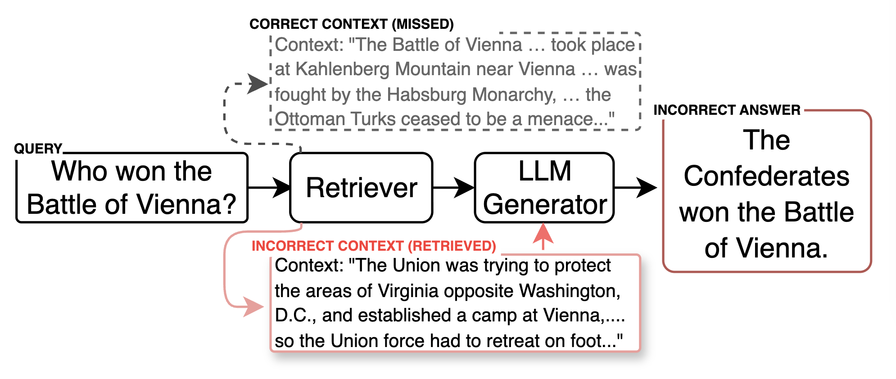

# Does RAG Answer Without Sufficient Evidence? Reusing IR Benchmarks for RAG Uncertainty Evaluation

<p align="center">
  <!-- <a href="https://doi.org/10.1145/3862322.3863847"></a> -->
  <a href="https://huggingface.co/datasets/trokhymovych/miracl-distractors"></a>
  <a href="LICENSE"></a>
</p>

<p align="center">
  
</p>

Code for the paper **"Does RAG Answer Without Sufficient Evidence? Reusing IR Benchmarks for RAG Uncertainty Evaluation"** (WSDM 2027, Findings).

We turn [MIRACL](https://huggingface.co/datasets/miracl/miracl) hard negatives (passages explicitly judged non-relevant) into a benchmark of distractors graded Easy / Medium / Hard by similarity to the answer, across 14 languages. We then test whether LLMs abstain or answer incorrectly when given only such a distractor, or a distractor next to the correct passage. Responses are labeled `ABSTAIN`, `CORRECT`, or `INCORRECT` by three LLM judges validated against expert annotation.

The [dataset](https://huggingface.co/datasets/trokhymovych/miracl-distractors) contains the benchmark, all model responses, judge labels, and human annotations.

## Repository

```text
configs/      Experiment configs (models, prompts, context modes)
data/         Benchmark, generations, judge labels, expert annotations; additional/ = gold-only control
notebooks/    experiments and analysis
src/rag_eval/ Generation and LLM-judge scripts
```

## Setup

```bash
git clone https://github.com/trokhymovych/rag-uncertainty-eval.git
cd rag-uncertainty-eval
python -m venv .venv && source .venv/bin/activate
pip install -r requirements.txt
export PYTHONPATH=$PWD/src:$PYTHONPATH
```

Put API keys in a `.env` file (`OPENAI_API_KEY` or `AZURE_OPENAI_*`, `ANTHROPIC_API_KEY`, `GEMINI_API_KEY`, `TOGETHER_API_KEY`). Open-weight models run locally with [Ollama](https://ollama.com/).

## Reproduce

All generations and judge labels are already in `data/`, so the paper results can be reproduced without any API calls by running [`notebooks/05_paper_results.ipynb`](notebooks/05_paper_results.ipynb) (and [`04_annotator_agreement.ipynb`](notebooks/04_annotator_agreement.ipynb)).

To rerun the pipeline:

```bash
python src/rag_eval/run_generation.py --config configs/experiments.yaml          # generate answers
python src/rag_eval/run_judge.py --config configs/experiments.yaml --input <generations.csv>   # judge them
bash run_additional_gold_only.sh                                                  # gold-only control
```

Prompts are in the config files; the judge prompt is in [`src/rag_eval/prompts.py`](src/rag_eval/prompts.py). Human annotation guidelines: [`resources/annotation_guidlines.md`](resources/annotation_guidlines.md).

## Citation

If you use this code or benchmark, please cite:

```bibtex
@inproceedings{trokhymovych2027rag,
  title     = {Does {RAG} Answer Without Sufficient Evidence? Reusing {IR} Benchmarks for {RAG} Uncertainty Evaluation},
  author    = {Trokhymovych, Mykola and Sumyk, Marta and Kosovan, Oleksandr and Saez-Trumper, Diego and Baeza-Yates, Ricardo},
  booktitle = {Proceedings of the Twentieth ACM International Conference on Web Search and Data Mining (WSDM 2027)},
  year      = {2027},
  address   = {Hong Kong},
  publisher = {ACM},
  note      = {Findings track},
  doi       = {10.1145/3862322.3863847}
}
```
Citation metadata is also available in [CITATION.cff](CITATION.cff).

---

## License

Code: Apache 2.0 (see [LICENSE](LICENSE)).
